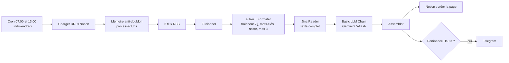

# Veille ADS — Client (n8n + Gemini)

> **EN:** n8n workflow that monitors 6 RSS feeds, filters articles by relevance, summarizes them with Gemini (LangChain) and stores them in Notion, with Telegram alerts for high-relevance items.
> **EN:** Built for marketing agencies: a weekday news digest delivered to a client workspace, capped at 3 articles per run to stay within API quotas.
> **EN:** Generated from a Python build script; all personal identifiers are placeholders (see *Configuration*).

**FR :** Workflow n8n de veille sectorielle qui lit 6 flux RSS, filtre par pertinence, résume chaque article avec Gemini et l'enregistre dans Notion, avec une alerte Telegram pour les articles à forte pertinence.

## Problème → Solution → Pour qui

- **Problème :** une agence marketing (ou son client) n'a pas le temps de suivre l'actualité Google Ads / Meta Ads / automatisation.
- **Solution :** 2 passages par jour en semaine, 3 articles maximum par passage, résumé actionnable en 3 points, archivage dans Notion, alerte Telegram sur les articles 🔥.
- **Pour qui :** agences PPC / automatisation qui veulent livrer une veille à un client sans la rédiger à la main. Adaptable à un autre sujet : les sources, les mots-clés et le prompt sont dans `build_veille_v18.py`.

## Résultat

Le dépôt ne contient pas d'enregistrement d'exécution réel. Voici donc la **structure de sortie**, déduite du code des nœuds *Assembler Article + Résumé IA* et *Résumé IA* (ce n'est pas un résultat d'exécution) :

| Entrée (article RSS) | Sortie Notion | Sortie Telegram (si 🔥 Haute) |
|---|---|---|
| titre, URL, source, extrait | Titre, Source, URL, Résumé (3 puces, 120 mots max, en français), Tags, Date, Pertinence (🔥 Haute / 🟡 Moyenne / ⬇️ Faible) | `🔥 *<titre>*` + résumé + `🔗 <url>` |

<!-- TODO capture: ligne Notion réelle (base veille remplie après une exécution) et message Telegram reçu -->

## Architecture

## Prérequis

- n8n avec les nœuds LangChain (Basic LLM Chain v1.9, Google Gemini Chat Model). La version minimale exacte n'a pas été vérifiée.
- Credentials n8n : Notion, Google Gemini API, Telegram (bot).
- Une base Notion avec les propriétés : Titre, Source, URL, Résumé, Tags, Date, Pertinence.
- Coût : non calculé dans ce dépôt. Le volume est borné à 3 articles × 2 passages par jour ouvré, soit 6 appels LLM par jour au plus.

## Installation

1. Créer la base Notion (propriétés ci-dessus) et la partager avec votre intégration Notion.
2. Dans `build_veille_v18.py`, renseigner `VEILLE_DB_ID` ; dans le nœud Telegram, renseigner votre chat ID. Régénérer le JSON : `python3 build_veille_v18.py` (ou modifier directement les nœuds après import).
3. n8n → **Workflows → Import from file** → `veille-ads-client-v18.json`.
4. Associer vos credentials Notion, Google Gemini API et Telegram sur chaque nœud concerné.
5. Lancer une exécution manuelle et vérifier qu'une page Notion est créée.
6. Activer le workflow.

## Configuration

| Placeholder / réglage | Où le trouver | Nœud concerné |
|---|---|---|
| `<YOUR_NOTION_DATABASE_ID>` | URL de la base Notion (32 caractères) | Charger URLs Notion, Notion — Créer Page |
| `<YOUR_TELEGRAM_CHAT_ID>` | Votre bot Telegram, par exemple via `getUpdates` | Telegram — Alerte |
| Credential Notion / Gemini / Telegram | n8n → Credentials | voir ci-dessus |
| Cron `0 7,13 * * 1-5` | Fuseau = celui de l'instance n8n | 7h + 13h Lun-Ven |

Les identifiants de credentials présents dans le JSON (`4rbkLch…` etc.) sont des identifiants internes d'une instance n8n : après import, ré-sélectionnez vos propres credentials.

## Statut et limites

- **Statut : base de départ.** Aucune exécution documentée dans ce dépôt.
- Filtre par mots-clés simples (sous-chaînes) : peut laisser passer ou rater des articles.
- Mémoire anti-doublon : `staticData` n8n + URLs déjà présentes dans Notion.
- Les erreurs LLM ou Telegram n'arrêtent pas le run (`continueOnFail`).
- Les contenus lus via Jina Reader (`r.jina.ai`) transitent par ce service tiers.
- `build_veille_v17.py` est conservé pour mémoire (voir `CHANGELOG.md`).

## Documentation détaillée des nœuds

Pour la description nœud par nœud, ouvrir le workflow dans n8n (la note *Guide* résume le flux) ou lire `build_veille_v18.py`, qui définit chaque nœud, prompt et code.

## Licence

MIT, voir [LICENSE](LICENSE).
